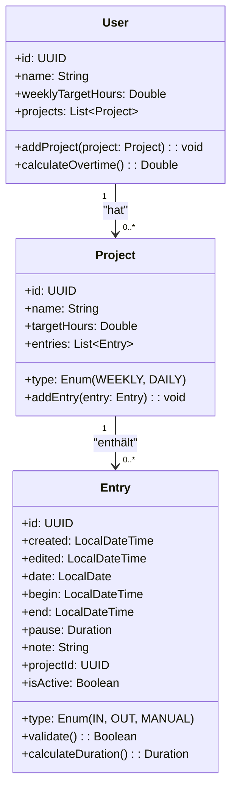
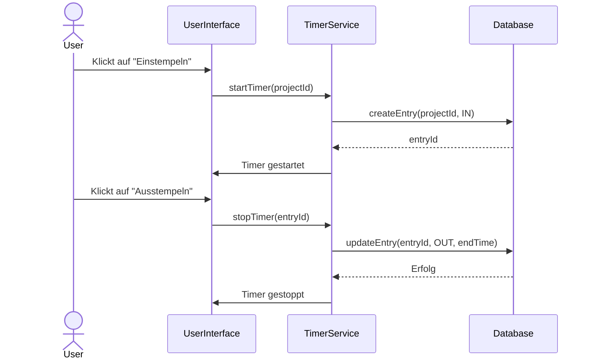
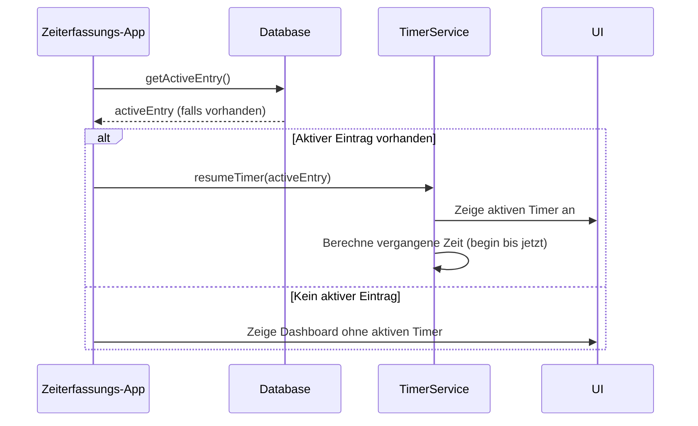
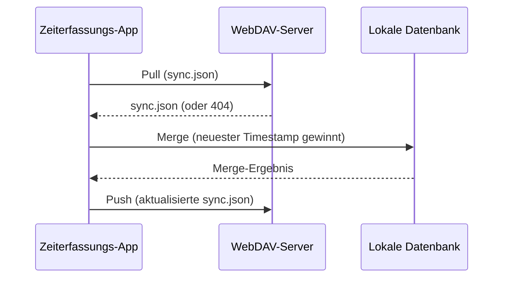
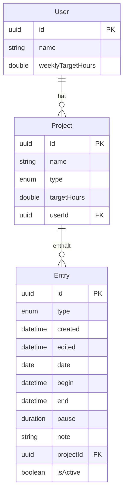
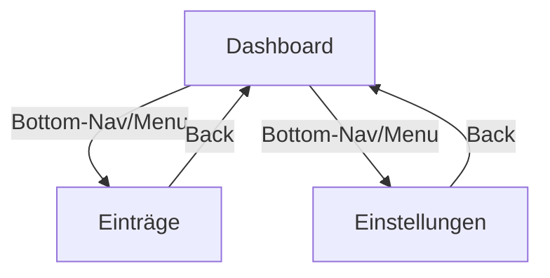

# **Zeiterfassungs-App: Plattformübergreifende Spezifikation**

*Version 1.1 – Stand: 29.07.2026*

---

## **1. Einleitung**

### **Zielgruppe**
Angestellte, Freelancer und kleine Teams, die ihre Arbeitszeiten erfassen und auswerten möchten.

### **Zweck**
- **Arbeitszeiterfassung**: Ein- und Ausstempeln mit Zeitstempeln.
- **Projektzuordnung**: Stunden pro Projekt tracken.
- **Überstundenberechnung**: Automatische Berechnung basierend auf Soll- und Ist-Stunden.
- **Synchronisation**: WebDAV-basierter Sync zwischen mehreren Geräten.
- **Persistenz**: Der Status der Zeiterfassung wird **sofort in der Datenbank gespeichert**, um Datenverlust zu vermeiden. Die App muss **nicht im Hintergrund laufen**, um den Timer aktiv zu halten.

### **Zielplattformen & Technologie-Stack**
| Plattform       | Technologie               | UI-Framework          | Datenbank          |
|-----------------|---------------------------|-----------------------|--------------------|
| **Android**     | Kotlin                    | Jetpack Compose       | Room (SQLite)      |
| **iOS**         | Swift                     | SwiftUI               | Core Data          |
| **Desktop**     | Python 3.11+              | PyQt/Tkinter          | SQLite (`sqlite3`) |

---

## **2. Architektur & Design**

### **2.1 Klassendiagramm (UML)**



---

### **2.2 Sequenzdiagramm: Timer-Start/Stop**



---

### **2.3 Sequenzdiagramm: App-Start mit aktivem Timer**



---

### **2.4 Sequenzdiagramm: WebDAV-Sync**



---

### **2.5 ER-Diagramm (Datenbank)**



---

## **3. Datenmodell & Persistenz**

### **3.1 Datenbank-Schema (plattformspezifisch)**

#### **Android (Room)**
```kotlin
@Entity
data class User(
    @PrimaryKey val id: UUID,
    val name: String,
    val weeklyTargetHours: Double
)

@Entity
data class Project(
    @PrimaryKey val id: UUID,
    val name: String,
    val type: HourType, // Enum: WEEKLY, DAILY
    val targetHours: Double,
    @ForeignKey val userId: UUID
)

@Entity
data class Entry(
    @PrimaryKey val id: UUID,
    val type: EntryType, // Enum: IN, OUT, MANUAL
    val created: LocalDateTime,
    val edited: LocalDateTime,
    val date: LocalDate,
    val begin: LocalDateTime,
    val end: LocalDateTime,
    val pause: Duration,
    val note: String,
    @ForeignKey val projectId: UUID,
    val isActive: Boolean
)
```

#### **iOS (Core Data)**
```swift
// User+CoreDataClass.swift
class User: NSManagedObject {
    @NSManaged var id: UUID
    @NSManaged var name: String
    @NSManaged var weeklyTargetHours: Double
    @NSManaged var projects: Set<Project>
}

// Project+CoreDataClass.swift
class Project: NSManagedObject {
    @NSManaged var id: UUID
    @NSManaged var name: String
    @NSManaged var type: String // "WEEKLY" oder "DAILY"
    @NSManaged var targetHours: Double
    @NSManaged var user: User
    @NSManaged var entries: Set<Entry>
}

// Entry+CoreDataClass.swift
class Entry: NSManagedObject {
    @NSManaged var id: UUID
    @NSManaged var type: String // "IN", "OUT", "MANUAL"
    @NSManaged var created: Date
    @NSManaged var edited: Date
    @NSManaged var date: Date
    @NSManaged var begin: Date
    @NSManaged var end: Date
    @NSManaged var pause: TimeInterval // in Sekunden
    @NSManaged var note: String?
    @NSManaged var project: Project
    @NSManaged var isActive: Bool
}
```

#### **Desktop (Python + SQLite)**
```python
from dataclasses import dataclass
from datetime import datetime, time, timedelta
from enum import Enum, auto
import uuid
from typing import Optional, List

class EntryType(Enum):
    IN = auto()
    OUT = auto()
    MANUAL = auto()

class HourType(Enum):
    WEEKLY = auto()
    DAILY = auto()

@dataclass
class User:
    id: uuid.UUID
    name: str
    weekly_target_hours: float
    projects: List["Project"]

@dataclass
class Project:
    id: uuid.UUID
    name: str
    type: HourType
    target_hours: float
    user_id: uuid.UUID
    entries: List["Entry"]

@dataclass
class Entry:
    id: uuid.UUID
    type: EntryType
    created: datetime
    edited: datetime
    date: datetime.date
    begin: datetime
    end: Optional[datetime]
    pause: timedelta
    note: Optional[str]
    project_id: uuid.UUID
    is_active: bool
```

---

### **3.2 Algorithmen**

#### **Überstundenberechnung (Pseudocode)**
```python
# Pseudocode für alle Plattformen
function calculate_overtime(user: User) -> Double:
    total_hours = 0.0
    for project in user.projects:
        for entry in project.entries:
            if entry.type == MANUAL or (entry.type == IN and entry.is_active == False):
                duration = (entry.end - entry.begin) - entry.pause
                total_hours += duration.total_seconds() / 3600  # Umrechnung in Stunden
    overtime = total_hours - user.weeklyTargetHours
    return max(0.0, overtime)  # Negative Werte = keine Überstunden
```

#### **Sortierlogik (Gruppierung nach ISO-Woche)**
```python
from datetime import datetime, timedelta

def get_iso_week(date: datetime.date) -> int:
    return date.isocalendar()[1]  # ISO-Wochen-Nummer (1-53)

def group_entries_by_week(entries: List[Entry]) -> Dict[int, List[Entry]]:
    groups = {}
    for entry in entries:
        week = get_iso_week(entry.date)
        if week not in groups:
            groups[week] = []
        groups[week].append(entry)
    return groups
```

#### **Berechnung der vergangenen Zeit beim App-Start**
```python
from datetime import datetime

def calculate_elapsed_time(entry: Entry) -> timedelta:
    """Berechnet die vergangene Zeit seit dem letzten Einstempeln."""
    if entry.is_active and entry.begin is not None:
        return datetime.now() - entry.begin
    return timedelta(0)
```

---

### **3.3 Beispieldaten (JSON)**

```json
{
  "users": [
    {
      "id": "550e8400-e29b-41d4-a716-446655440000",
      "name": "Luis Rodriguez Hofheinz",
      "weeklyTargetHours": 40.0
    }
  ],
  "projects": [
    {
      "id": "550e8400-e29b-41d4-a716-446655440001",
      "name": "Zeiterfassungs-App",
      "type": "WEEKLY",
      "targetHours": 20.0,
      "userId": "550e8400-e29b-41d4-a716-446655440000"
    }
  ],
  "entries": [
    {
      "id": "550e8400-e29b-41d4-a716-446655440002",
      "type": "IN",
      "created": "2026-07-29T08:00:00",
      "edited": "2026-07-29T08:00:00",
      "date": "2026-07-29",
      "begin": "2026-07-29T08:00:00",
      "end": null,
      "pause": "PT0S",
      "note": null,
      "projectId": "550e8400-e29b-41d4-a716-446655440001",
      "isActive": true
    },
    {
      "id": "550e8400-e29b-41d4-a716-446655440003",
      "type": "OUT",
      "created": "2026-07-29T12:00:00",
      "edited": "2026-07-29T12:00:00",
      "date": "2026-07-29",
      "begin": "2026-07-29T08:00:00",
      "end": "2026-07-29T12:00:00",
      "pause": "PT30M",
      "note": "Mittagspause",
      "projectId": "550e8400-e29b-41d4-a716-446655440001",
      "isActive": false
    }
  ]
}
```

---

## **4. UI/UX-Spezifikation**

### **4.1 Navigation (Mermaid)**



---

### **4.2 Wireframes (ASCII-Mockups)**

#### **Dashboard (Android/iOS/Desktop)**
```
+-------------------------------------+
| [App Bar: Zeiterfassung]             |
+-------------------------------------+
| [LinearProgressIndicator: 8/40h]     |
+-------------------------------------+
|                                     |
|  [Button: Einstempeln]  [Button: Aus- |
|  stempeln]                          |
|                                     |
+-------------------------------------+
| Übersicht:                          |
| - Heute: 4h                         |
| - Diese Woche: 24h                  |
| - Überstunden: +2h                  |
+-------------------------------------+
| [Tab: Dashboard] [Tab: Einträge]    |
| [Tab: Einstellungen]                |
+-------------------------------------+
```

#### **Einträge (Liste)**
```
+-------------------------------------+
| [App Bar: Einträge]                  |
+-------------------------------------+
| [Filter: Heute | Woche | Monat]      |
+-------------------------------------+
| +-------------------------------+    |
| | Projekt: Zeiterfassung          |    |
| | 08:00 - 12:00 | Pause: 30m    |    |
| | Note: Mittagspause              |    |
| +-------------------------------+    |
| +-------------------------------+    |
| | Projekt: Meeting               |    |
| | 13:00 - 14:30                 |    |
| +-------------------------------+    |
+-------------------------------------+
| [FAB: +]                            |
+-------------------------------------+
```

#### **Manueller Eintrag (Dialog)**
```
+-------------------------------------+
| [Dialog: Neuer Eintrag]              |
+-------------------------------------+
| Projekt: [Dropdown]                  |
| Beginn: [TimePicker]                 |
| Ende: [TimePicker]                   |
| Pause: [DurationPicker]              |
| Bemerkung: [______________]         |
+-------------------------------------+
| [Button: Abbrechen] [Button: Speichern]|
+-------------------------------------+
```

---

### **4.3 Plattform-spezifische UI-Komponenten**

| **Funktion**          | **Android (Material3)**          | **iOS (SwiftUI)**               | **Desktop (PyQt)**               |
|------------------------|-----------------------------------|----------------------------------|----------------------------------|
| **Fortschrittsbalken** | `LinearProgressIndicator`        | `ProgressView`                   | `QProgressBar`                   |
| **Liste**             | `LazyColumn`                      | `List`                            | `QListWidget`                    |
| **Button**            | `FilledButton`                    | `Button`                         | `QPushButton`                    |
| **Dialog**            | `AlertDialog`                     | `sheet` (Modal)                  | `QDialog`                        |
| **Datum/Zeit**        | `DatePicker` / `TimePicker`       | `DatePicker` / `TimePicker`      | `QDateEdit` / `QTimeEdit`        |
| **Navigation**        | `BottomNavigation`                | `TabView`                        | `QTabWidget` / `QStackedWidget`  |

---

## **5. Funktionalitäten**

### **5.1 Must-Haves**

| **ID** | **Funktion**                     | **Beschreibung**                                                                                     | **Priorität** |
|--------|----------------------------------|-----------------------------------------------------------------------------------------------------|---------------|
| F1     | Timer: Ein-/Ausstempeln           | Startet/stoppt die Zeiterfassung mit `LocalDateTime`. **Status wird sofort in der Datenbank gespeichert.** | Hoch          |
| F2     | Manuelle Einträge                | Erlaubt das Hinzufügen/Bearbeiten von Einträgen mit Validierung (`Ende > Beginn`).                 | Hoch          |
| F3     | Überstundenberechnung            | Berechnet `Überstunden = (Ist-Stunden) - (Soll-Stunden)` pro Woche.                                  | Hoch          |
| F4     | Projektzuordnung                | Jeder Eintrag muss einem Projekt zugeordnet sein. Projekte haben `Name`, `Typ`, `Soll-Stunden`.   | Hoch          |
| F5     | Lokale Speicherung               | Daten werden plattformspezifisch persistiert (Room/Core Data/SQLite). **Aktiver Timer wird bei App-Start zurückgerechnet.** | Hoch          |
| F6     | WebDAV-Sync                       | Sync-Datei (`sync.json`) wird per WebDAV synchronisiert (Pull → Merge → Push).                     | Hoch          |

---

### **5.2 Nice-to-Haves**

| **ID** | **Funktion**                     | **Beschreibung**                                                                                     | **Priorität** |
|--------|----------------------------------|-----------------------------------------------------------------------------------------------------|---------------|
| F7     | Pausenfunktion                   | Manuelle oder automatische Pausen-Erfassung (z. B. 30 Minuten Abzug).                              | Mittel        |
| F8     | Urlaubstage-Tracking             | Kalenderintegration zur Verwaltung von Urlaubstagen.                                                | Niedrig       |
| F9     | Export (CSV/Excel)               | Filterbare Export-Funktion für Einträge/Projekte.                                                  | Mittel        |
| F10    | Datenvisualisierung              | Balken-/Kreisdiagramm für Wochen-/Monatsübersicht.                                                 | Niedrig       |

---

## **6. Synchronisation (WebDAV)**

### **6.1 Sync-Logik**
1. **Pull**: App lädt `sync.json` vom WebDAV-Server.
2. **Merge**: Lokale Daten werden mit `sync.json` gemerged.
    - **Konfliktlösung**: Neuester `edited`-Timestamp gewinnt.
3. **Push**: Aktualisierte `sync.json` wird zurück auf den Server geladen.

### **6.2 Sync-Datei-Format (`sync.json`)**
```json
{
  "metadata": {
    "version": "1.0",
    "lastSync": "2026-07-29T12:00:00Z",
    "appVersion": "1.0.0"
  },
  "data": {
    "users": [...],
    "projects": [...],
    "entries": [...]
  }
}
```

---

## **7. Testfälle**

### **7.1 Unit-Tests (Business-Logik)**

| **ID** | **Testfall**                          | **Erwartetes Ergebnis**                                                                 |
|--------|---------------------------------------|-----------------------------------------------------------------------------------------|
| T1     | `calculateOvertime()` mit 42h Ist / 40h Soll | `2.0` Überstunden                                                                       |
| T2     | `validateEntry()` mit `Ende < Beginn` | `False` (ungültiger Eintrag)                                                            |
| T3     | `groupEntriesByWeek()`                | Einträge werden korrekt nach ISO-Woche gruppiert.                                       |
| T4     | `mergeSyncData()` mit Konflikt        | Neuester `edited`-Timestamp wird beibehalten.                                           |
| T5     | `calculateElapsedTime()`              | Korrekte Berechnung der vergangenen Zeit seit dem letzten Einstempeln.                 |

---

### **7.2 UI-Tests (Kritische User-Journeys)**

| **ID** | **Testfall**                          | **Schritte**                                                                           | **Erwartetes Ergebnis**                     |
|--------|---------------------------------------|---------------------------------------------------------------------------------------|---------------------------------------------|
| T6     | Timer-Start/Stop                      | 1. App öffnen → Dashboard. 2. "Einstempeln" klicken. 3. "Ausstempeln" klicken.        | Eintrag wird erstellt und Timer stoppt.     |
| T7     | Manueller Eintrag                     | 1. "Einträge" → "+" → Formular ausfüllen → Speichern.                                | Eintrag erscheint in der Liste.            |
| T8     | App-Neustart mit aktivem Timer        | 1. Einstempeln → App schließen → App neu öffnen.                                        | Aktiver Timer wird angezeigt und Zeit zurückgerechnet. |
| T9     | WebDAV-Sync                           | 1. Offline: Eintrag erstellen. 2. Online gehen → Sync auslösen.                        | Eintrag wird auf Server synchronisiert.     |

---

## **8. Offene Fragen & zukünftige Erweiterungen**

### **8.1 Offene Fragen**
- [ ] Soll die App **Mehrfach-Nutzer** unterstützen (z. B. für Teams)?
- [ ] Soll es eine **Admin-Rolle** geben (z. B. für Teamleiter)?
- [ ] Wie sollen **Sync-Konflikte** gelöst werden, wenn zwei Geräte gleichzeitig ändern?
- [ ] Soll die App **Benachrichtigungen** senden (z. B. nach 8 Stunden Arbeit)?
- [ ] Soll die **Pausenfunktion** automatisch nach X Stunden aktiviert werden?

### **8.2 Roadmap**

| **Version** | **Features**                          | **Zeitraum** | **Status**      |
|-------------|---------------------------------------|--------------|-----------------|
| v1.0        | Timer, Einträge, Überstunden, lokale Speicherung | 2 Wochen      | **In Arbeit**  |
| v1.1        | WebDAV-Sync, Projektzuordnung         | 1 Woche       | Geplant         |
| v2.0        | Urlaubstage, Export, Diagramme        | 3 Wochen      | Geplant         |
| v2.1        | Benachrichtigungen, Cloud-Sync       | 2 Wochen      | Backlog         |

---

## **9. Glossar**

| **Begriff**         | **Definition**                                                                                     |
|---------------------|----------------------------------------------------------------------------------------------------|
| **Einstempeln**     | Start der Zeiterfassung (Erstellung eines `../src/data/entry.py` mit `type=IN`).                              |
| **Ausstempeln**     | Ende der Zeiterfassung (Aktualisierung des `../src/data/entry.py` mit `type=OUT` und `end`-Zeitstempel).        |
| **Soll-Stunden**    | Geplante Arbeitszeit pro Woche/Tag (z. B. 40h/Woche).                                             |
| **WebDAV**          | Protokoll zur Dateisynchronisation (z. B. Nextcloud, OwnCloud).                                  |
| **ISO-Woche**       | Kalenderwoche nach ISO-8601 (Montag = Woche 1, Sonntag = Woche 7).                             |

---

## **10. Anhang: Code-Snippets**

### **10.1 Android: Timer-Service (Kotlin)**
```kotlin
class TimerService(private val entryRepository: EntryRepository) {
    fun startTimer(projectId: UUID) {
        val activeEntry = Entry(
            id = UUID.randomUUID(),
            type = EntryType.IN,
            created = LocalDateTime.now(),
            edited = LocalDateTime.now(),
            date = LocalDate.now(),
            begin = LocalDateTime.now(),
            end = null,
            pause = Duration.ZERO,
            note = null,
            projectId = projectId,
            isActive = true
        )
        entryRepository.insert(activeEntry) // Sofort in der DB speichern
    }

    fun stopTimer(entryId: UUID) {
        val entry = entryRepository.getById(entryId)
        entry?.let {
            val updatedEntry = it.copy(
                type = EntryType.OUT,
                end = LocalDateTime.now(),
                edited = LocalDateTime.now(),
                isActive = false
            )
            entryRepository.update(updatedEntry) // Sofort in der DB speichern
        }
    }

    fun getActiveEntry(): Entry? {
        return entryRepository.getActiveEntry()
    }
}
```

---

### **10.2 iOS: Timer-Service (Swift)**
```swift
class TimerService {
    private let entryRepository: EntryRepository

    init(entryRepository: EntryRepository) {
        self.entryRepository = entryRepository
    }

    func startTimer(projectId: UUID) {
        let newEntry = Entry(context: entryRepository.context)
        newEntry.id = UUID()
        newEntry.type = "IN"
        newEntry.created = Date()
        newEntry.edited = Date()
        newEntry.date = Calendar.current.startOfDay(for: Date())
        newEntry.begin = Date()
        newEntry.end = nil
        newEntry.pause = 0
        newEntry.note = nil
        newEntry.projectId = projectId
        newEntry.isActive = true
        entryRepository.save() // Sofort speichern
    }

    func stopTimer(entryId: UUID) {
        if let entry = entryRepository.getById(entryId) {
            entry.type = "OUT"
            entry.end = Date()
            entry.edited = Date()
            entry.isActive = false
            entryRepository.save() // Sofort speichern
        }
    }

    func getActiveEntry() -> Entry? {
        return entryRepository.getActiveEntry()
    }
}
```

---

### **10.3 Desktop: Timer-Service (Python)**
```python
from datetime import datetime, timedelta
from typing import Optional
import uuid

class TimerService:
    def __init__(self, entry_repository: "EntryRepository"):
        self.entry_repository = entry_repository

    def start_timer(self, project_id: uuid.UUID) -> None:
        active_entry = Entry(
            id=uuid.uuid4(),
            type=EntryType.IN,
            created=datetime.now(),
            edited=datetime.now(),
            date=datetime.now().date(),
            begin=datetime.now(),
            end=None,
            pause=timedelta(0),
            note=None,
            project_id=project_id,
            is_active=True
        )
        self.entry_repository.insert(active_entry)  # Sofort speichern

    def stop_timer(self, entry_id: uuid.UUID) -> None:
        entry = self.entry_repository.get_by_id(entry_id)
        if entry:
            entry.end = datetime.now()
            entry.edited = datetime.now()
            entry.is_active = False
            self.entry_repository.update(entry)  # Sofort speichern

    def get_active_entry(self) -> Optional[Entry]:
        return self.entry_repository.get_active_entry()

    def calculate_elapsed_time(self, entry: Entry) -> timedelta:
        """Berechnet die vergangene Zeit seit dem letzten Einstempeln."""
        if entry.is_active and entry.begin:
            return datetime.now() - entry.begin
        return timedelta(0)
```

---

### **10.4 App-Start-Logik (Python-Beispiel)**
```python
class App:
    def __init__(self, timer_service: TimerService, ui: "UserInterface"):
        self.timer_service = timer_service
        self.ui = ui

    def on_start(self) -> None:
        active_entry = self.timer_service.get_active_entry()
        if active_entry:
            elapsed_time = self.timer_service.calculate_elapsed_time(active_entry)
            self.ui.show_active_timer(elapsed_time)
        else:
            self.ui.show_dashboard()
```

---

### **10.5 WebDAV-Sync (Python-Beispiel)**
```python
import requests
from pathlib import Path
import json
from datetime import datetime

class WebDAVSync:
    def __init__(self, base_url: str, username: str, password: str):
        self.base_url = base_url.rstrip('/')
        self.auth = (username, password)

    def pull_sync_file(self) -> dict:
        url = f"{self.base_url}/sync.json"
        response = requests.get(url, auth=self.auth)
        if response.status_code == 200:
            return response.json()
        return {"metadata": {"lastSync": None}, "data": {"users": [], "projects": [], "entries": []}}

    def push_sync_file(self, data: dict) -> bool:
        url = f"{self.base_url}/sync.json"
        response = requests.put(
            url,
            auth=self.auth,
            data=json.dumps(data),
            headers={"Content-Type": "application/json"}
        )
        return response.status_code == 201 or response.status_code == 204

    def merge_data(self, local_data: dict, remote_data: dict) -> dict:
        # Einfache Merge-Logik: Neuester Timestamp gewinnt
        merged = {"users": [], "projects": [], "entries": []}
        
        # Merge Users
        local_users = {u["id"]: u for u in local_data["users"]}
        remote_users = {u["id"]: u for u in remote_data["users"]}
        for user_id in set(local_users.keys()).union(remote_users.keys()):
            local_user = local_users.get(user_id, {"edited": None})
            remote_user = remote_users.get(user_id, {"edited": None})
            if local_user["edited"] > remote_user["edited"]:
                merged["users"].append(local_user)
            else:
                merged["users"].append(remote_user)

        # Ähnlich für Projects und Entries
        # ... (analog implementieren)
        
        return {
            "metadata": {
                "version": "1.0",
                "lastSync": datetime.utcnow().isoformat() + "Z",
                "appVersion": "1.0.0"
            },
            "data": merged
        }
```

---

## **11. Zusammenfassung & Nächste Schritte**

### **Zusammenfassung**
Dieses Dokument definiert eine **plattformübergreifende Zeiterfassungs-App** mit:
- **Klaren Anforderungen** für Android, iOS und Desktop.
- **Detaillierten UML-Diagrammen** (Klassen, Sequenz, ER).
- **Plattformspezifischen Code-Snippets** für Kotlin, Swift und Python.
- **Testfällen** für kritische Funktionen.
- **Sync-Logik** für WebDAV.
- **Persistenter Speicherung des Timer-Status**: Der Status wird sofort in der Datenbank gespeichert, und bei App-Neustart wird der letzte Stand zurückgerechnet.

### **Nächste Schritte**
1. **Feedback einholen**: Offene Fragen klären (z. B. Mehrfach-Nutzer, Admin-Rolle).
2. **Prototyp implementieren**: Beginn mit der **Android-Version** (Kotlin + Room).
3. **Sync testen**: WebDAV-Sync mit einem lokalen Server (z. B. Nextcloud) validieren.
4. **UI/UX finalisieren**: Wireframes in echte UI-Komponenten umsetzen.